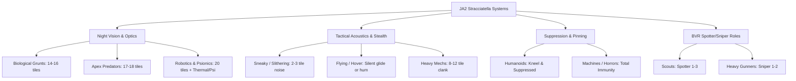

# Jagged Alliance 2 Straciatella Alien Rebalance & Sensory Overhaul
### Asymmetrical Night Vision, Auditory Stealth, Suppression Resistances, and Spotter AI Roles

> [← Back to Documentation Overview](ja2_stracciatella_mods_overview.md)

---

## 1. Overview & Architectural Rationale

In vanilla OpenXcom, aliens were designed around the constraints of a 1994 engine:
1. **Omniscient 20-Tile Night Vision**: All aliens—from low-tier biological Sectoids to blind underground Silacoids—possessed flat 20-tile vision in pitch black darkness.
2. **Deafness & Global Hivemind**: Units could not hear footsteps, door breaches, or nearby gunfire unless direct line-of-sight was achieved, or global alerts activated.
3. **No Suppression or Pinning**: Heavy weaponry was purely lethal; near-misses did not shake morale, force units into cover, or degrade reaction readiness.
4. **Uniform Stance & Bipod Dynamics**: Kneeling offered a flat modifier with no weapon-specific stabilization or stance restrictions.
5. **Universal Movement Noise**: Flying units and slithering reptiles produced identical acoustic footprints to heavy combat boots.

With the **Jagged Alliance 2 Stracciatella (JA2S)** modifications active:
* **Tactical Acoustics & Awareness**: Guards track sound in 3D space, transitioning across `STATUS_GREEN`, `STATUS_YELLOW`, and `STATUS_RED`.
* **Tactical Suppression**: Near-misses apply suppression points, forcing units into defensive kneeling and draining Time Units.
* **Tactical Ballistics & Beyond-Visual-Range (BVR)**: Targets outside personal sight suffer a 50% accuracy penalty unless designated by spotters.
* **Interactive Reaction Interrupts**: Reaction scores dynamically contest turns, with intelligent AI mode selection (Auto at $\le 6$ tiles, Aimed at $\ge 15$ tiles).

To bring enemies in line with these tactical systems, this guide specifies species-specific sensory, acoustic, psychological, and AI parameters.

---

## 2. Core Sensory & Tactical Dimensions



### 2.1 Asymmetrical Night Vision & Thermal Optics
Instead of vanilla's flat 20-tile night vision for all hostile units:
* **Tier 1 (Biological Line Infantry - 14–16 tiles)**: Sectoids, Floaters, Mutons, Snakemen. Superior to baseline human daylight vision (12 tiles), but constrained compared to military electro-optics (16 tiles).
* **Tier 2 (Apex Hunters - 16–18 tiles)**: Reapers, Chryssalids. Biological nocturnal adaptations and tapetum lucidum reflection.
* **Tier 3 (Technological & Psionic Masters - 20 tiles)**: Cyberdiscs, Sectopods, Ethereals. Active laser/radar thermal imaging (`heatVision: 100%`) or psionic clairvoyance (`psiVision: 12–16 tiles`), penetrating darkness, smoke screens, and solid obstacles.

### 2.2 Suppression Resistances & Forced Kneeling
* **Humanoid Infantry (Mutons, Sectoids)**: Full suppression vulnerability. Under concentrated fire, they dive into waist-high cover (`allowsKneeling: true`), losing reaction overwatch and up to 25% TUs. Mutons capitalize on kneeling due to bipod simulation (+20% to +45% accuracy on heavy weapons).
* **Mindless Horrors (Chryssalids, Silacoids, Zombies)**: Immune to suppression pinning (`fearImmune: true`, `allowsKneeling: false`). They disregard suppressing fire and charge relentlessly.
* **Autonomous War Machines (Cyberdiscs, Sectopods)**: Mechanical platforms have no biological ducking reflex (`fearImmune: true`, `allowsKneeling: false`). Their aim is unaffected by near-misses.
* **Psionic Lords (Ethereals)**: Levitation and telekinetic barriers negate standard physical suppression.

### 2.3 Acoustic Profiles, Auditory Acuity, and Stealth Movement

```
MoveNoise = ActionBaseNoise * NoiseMovementFactor
EffVolume = NoiseVolume + HearingBonus - DistanceInTiles - Attenuation
```

* **Airborne Flight / Anti-Grav Gliding (`noiseMovementFly: 0`)**: Units flying in mid-air (`MT_FLY` or `isFloating()`) produce zero ground vibration or impact footstep noise. Floaters, Cyberdiscs, and soldiers wearing Flying Suits glide completely silently through the air.
* **Player Sneaking via <kbd>Alt</kbd> Key (`noiseMovementSneak: 1`)**: Soldiers holding <kbd>Alt</kbd> execute the JA2 stealth creep: movement speed is halved, but footstep noise drops to a near-inaudible **1-tile radius**. This allows stacking up quietly outside UFO doors and setting up close-quarters ambushes without alerting guards.
* **Species Acoustic Footprints (`noiseMovementFactor`)**:
  - **Stealth Stalkers**: Snakemen (`0.5`) slither almost soundlessly across terrain (3 tiles walking noise); Chryssalids (`0.6`) stalk on padded claws (3–4 tiles). Ethereals (`0.3`) levitate in near-total silence (1–2 tiles).
  - **Heavy Walkers**: Sectopods (`2.0`) stomp with thunderous multi-ton mechanical footfalls (12 tiles walking, 28 tiles sprinting). Cyberdiscs and Reapers (`1.5`) generate heavy vibration (9 tiles walking).
* **Auditory Hearing Acuity (`hearingBonus`)**:
  - Acute predatory senses: Reapers (`+5`) and Chryssalids (`+4`) detect footsteps and door breaches from significantly greater distances.
  - Dampened audio sensors: Mutons in sealed power helmets (`-2`) and Sectopods with filtered combat audio (`-3`) only react to closer disturbances or gunfire.

### 2.4 Spotter and Sniper Synergy
With the BVR 50% accuracy penalty active:
* **Spotters (`spotter: 1–3`)**: High-mobility scouts (Floaters, Cyberdiscs, Sectoid Navigators) relay player positions.
* **Snipers (`sniper: 1–3`)**: Heavy support weapons (Muton Heavy Plasma gunners, Sectopods) act on spotter coordinates to deliver long-range fire without personal line-of-sight penalties.

---

## 3. Comprehensive Alien Roster Specifications

| Alien Race / Unit | Armor Rule | Night Vision | Thermal (`heatVision`) | Psi Vision | Can Kneel | Suppression | Noise Factor | Hearing Bonus | Spotter / Sniper Role |
| :--- | :--- | :---: | :---: | :---: | :---: | :---: | :---: | :---: | :---: |
| **Sectoid Soldier** | `SECTOID_ARMOR0` | 14 | 0% | 0 | Yes | Vulnerable | 1.0 (6 tiles) | 0 | None |
| **Sectoid Navigator** | `SECTOID_ARMOR0` | 14 | 0% | 0 | Yes | Vulnerable | 1.0 (6 tiles) | 0 | Spotter 1 |
| **Sectoid Leader** | `SECTOID_ARMOR0` | 15 | 0% | 4 | Yes | Vulnerable | 1.0 (6 tiles) | 0 | Spotter 1 |
| **Sectoid Commander** | `SECTOID_ARMOR0` | 15 | 0% | 6 | Yes | Vulnerable | 1.0 (6 tiles) | 0 | Spotter 2 |
| **Cyberdisc** | `CYBERDISC_ARMOR` | 20 | 100% | 0 | No | **Immune** | 1.5 (Air: 0) | 0 | Spotter 2 |
| **Floater Soldier** | `FLOATER_ARMOR0` | 14 | 0% | 0 | No | Moderate | Air: 0 tiles | 0 | None |
| **Floater Navigator** | `FLOATER_ARMOR0` | 14 | 0% | 0 | No | Moderate | Air: 0 tiles | 0 | Spotter 2 |
| **Floater Leader** | `FLOATER_ARMOR1` | 15 | 0% | 0 | No | Moderate | Air: 0 tiles | 0 | Spotter 1 |
| **Reaper** | `REAPER_ARMOR` | 16 | 0% | 0 | No | Resistant | 1.5 (9 tiles) | **+5** | None |
| **Snakeman Soldier** | `SNAKEMAN_ARMOR0` | 16 | 50% | 0 | No | Moderate | **0.5 (3 tiles)**| 0 | None |
| **Snakeman Leader** | `SNAKEMAN_ARMOR1` | 16 | 50% | 0 | No | Moderate | **0.5 (3 tiles)**| 0 | Spotter 1 |
| **Chryssalid** | `CHRYSSALID_ARMOR` | 18 | 0% | 0 | No | **Immune** | **0.6 (3 tiles)**| **+4** | Aggressor |
| **Zombie** | `ZOMBIE_ARMOR` | 10 | 0% | 0 | No | **Immune** | 1.2 (7 tiles) | -2 | None |
| **Muton Soldier** | `MUTON_ARMOR0` | 15 | 0% | 0 | Yes | Tactical Kneel | 1.2 (7 tiles) | -2 | Sniper 1 |
| **Muton Navigator** | `MUTON_ARMOR1` | 15 | 0% | 0 | Yes | Tactical Kneel | 1.2 (7 tiles) | -2 | Spotter 1 |
| **Muton Engineer** | `MUTON_ARMOR2` | 15 | 0% | 0 | Yes | Tactical Kneel | 1.2 (7 tiles) | -2 | Sniper 2 |
| **Silacoid** | `SILACOID_ARMOR` | 9 | 100% | 0 | No | **Immune** | 0.7 (4 tiles) | +3 | None |
| **Celatid** | `CELATID_ARMOR` | 12 | 0% | 0 | No | Vulnerable | Air: 0 tiles | 0 | None |
| **Ethereal Soldier** | `ETHEREAL_ARMOR0` | 20 | 75% | 12 | No | **Immune** | **0.3 (1 tile)** | 0 | Sniper 1 |
| **Ethereal Leader** | `ETHEREAL_ARMOR1` | 20 | 75% | 14 | No | **Immune** | **0.3 (1 tile)** | 0 | Spotter 2 / Sniper 2 |
| **Ethereal Commander**| `ETHEREAL_ARMOR2` | 20 | 100% | 16 | No | **Immune** | **0.3 (1 tile)** | 0 | Spotter 3 / Sniper 3 |
| **Sectopod** | `SECTOPOD_ARMOR` | 20 | 100% | 0 | No | **Immune** | **2.0 (12 tiles)**| **-3** | Sniper 3 |

---

## 4. In-Depth Unit Breakdown

### 4.1 Sectoids & Cyberdiscs
* **Sectoid**: Fragile reconnaissance grunts. With 14 tiles of night vision, players armed with 16-tile electro-optics can spot and engage Sectoids from the darkness. When suppressed, Sectoids immediately drop down (`allowsKneeling: true`), breaking overwatch. Leaders project mild psionic awareness (`psiVision: 4–6`), detecting soldiers stacking outside UFO entrances.
* **Cyberdisc**: Heavy automated battle platform. Possesses uninhibited 20-tile vision, 100% thermal smoke penetration, and total suppression immunity. Acts as an airborne forward spotter (`spotter: 2`) directing Sectoid long-range plasma fire.

### 4.2 Floaters & Reapers
* **Floater**: Cybernetically augmented scouts. Lacking lower limbs, they cannot kneel (`allowsKneeling: false`). Navigators fly to high vantage points to serve as primary aerial spotters (`spotter: 2`).
* **Reaper**: Huge predatory bio-weapon. Senses target footsteps and movement vibrations across large distances. With 16 tiles of low-light vision and high health, it stalks sound sources aggressively.

### 4.3 Snakemen & Chryssalids
* **Snakeman**: Cold-blooded reptilian ambushers. Heat-sensitive pit organs grant `heatVision: 50%`, allowing partial visibility through smoke screens. Low baseline reaction stat (45) allows prepared players with full TUs to trigger interactive interrupts reliably.
* **Chryssalid**: The premier close-quarters terror. Chitinous carapace, compound night vision (18 tiles), and acute hearing. Immune to suppression pinning, with 70 Reactions and 110 TUs, making uncoordinated breaches suicidal without pre-emptive flashbangs or door charges.

### 4.4 Mutons
* **Muton**: Disciplined heavy shock infantry. Possess full tactical integration with JA2 mechanics:
  - When suppressed by heavy weapons fire, Mutons drop to their knees (`allowsKneeling: true`).
  - While kneeling, they gain the simulated **Bipod Deployment Bonus** (+20% to +45% accuracy) on Heavy Plasma and Auto-Cannons.
  - Engineers and Soldiers act as designated snipers (`sniper: 1–2`), firing devastating aimed shots at targets painted by spotters.

### 4.5 Ethereals & Sectopods
* **Ethereal**: Masters of psionic warfare. They navigate via mental awareness (`psiVision: 12–16 tiles`), detecting soldiers through walls. Their psionic field pierces smoke (`heatVision: 75%–100%`). Complete suppression immunity and 75 Reaction initiative.
* **Sectopod**: Heavily armored bipedal dreadnought. 20-tile active targeting sensors, 100% smoke penetration, and immune to suppression. Acts as the ultimate fire-support platform (`sniper: 3`), engaging targets spotted by Ethereals across the entire battlescape.

---

## 5. Ready-to-Use Ruleset Configuration

Below is the complete YAML ruleset block to implement this rebalance:

```yaml
# =========================================================================
# Jagged Alliance 2 Stracciatella Alien Sensory & Tactical Rebalance
# =========================================================================

armors:
  # SECTOIDS
  - type: SECTOID_ARMOR0
    visibilityAtDark: 14
    allowsKneeling: true

  # CYBERDISC
  - type: CYBERDISC_ARMOR
    visibilityAtDark: 20
    heatVision: 100
    fearImmune: true
    allowsKneeling: false

  # FLOATERS
  - type: FLOATER_ARMOR0
    visibilityAtDark: 14
    allowsKneeling: false

  - type: FLOATER_ARMOR1
    visibilityAtDark: 15
    allowsKneeling: false

  - type: FLOATER_ARMOR2
    visibilityAtDark: 15
    allowsKneeling: false

  # REAPER
  - type: REAPER_ARMOR
    visibilityAtDark: 16
    allowsKneeling: false

  # SNAKEMEN
  - type: SNAKEMAN_ARMOR0
    visibilityAtDark: 16
    heatVision: 50
    allowsKneeling: false

  - type: SNAKEMAN_ARMOR1
    visibilityAtDark: 16
    heatVision: 50
    allowsKneeling: false

  - type: SNAKEMAN_ARMOR2
    visibilityAtDark: 16
    heatVision: 50
    allowsKneeling: false

  # CHRYSSALID
  - type: CHRYSSALID_ARMOR
    visibilityAtDark: 18
    fearImmune: true
    allowsKneeling: false

  # ZOMBIE
  - type: ZOMBIE_ARMOR
    visibilityAtDark: 10
    fearImmune: true
    painImmune: true
    allowsKneeling: false

  # MUTONS
  - type: MUTON_ARMOR0
    visibilityAtDark: 15
    allowsKneeling: true

  - type: MUTON_ARMOR1
    visibilityAtDark: 15
    allowsKneeling: true

  - type: MUTON_ARMOR2
    visibilityAtDark: 15
    allowsKneeling: true

  # SILACOID
  - type: SILACOID_ARMOR
    visibilityAtDark: 9
    heatVision: 100
    fearImmune: true
    allowsKneeling: false

  # CELATID
  - type: CELATID_ARMOR
    visibilityAtDark: 12
    allowsKneeling: false

  # ETHEREALS
  - type: ETHEREAL_ARMOR0
    visibilityAtDark: 20
    heatVision: 75
    psiVision: 12
    fearImmune: true
    allowsKneeling: false

  - type: ETHEREAL_ARMOR1
    visibilityAtDark: 20
    heatVision: 75
    psiVision: 14
    fearImmune: true
    allowsKneeling: false

  - type: ETHEREAL_ARMOR2
    visibilityAtDark: 20
    heatVision: 100
    psiVision: 16
    fearImmune: true
    allowsKneeling: false

  # SECTOPOD
  - type: SECTOPOD_ARMOR
    visibilityAtDark: 20
    heatVision: 100
    fearImmune: true
    allowsKneeling: false

units:
  # Spotter / Sniper Network Adjustments
  - type: STR_SECTOID_NAVIGATOR
    spotter: 1

  - type: STR_SECTOID_LEADER
    spotter: 1

  - type: STR_SECTOID_COMMANDER
    spotter: 2

  - type: STR_CYBERDISC_TERRORIST
    spotter: 2

  - type: STR_FLOATER_NAVIGATOR
    spotter: 2

  - type: STR_FLOATER_LEADER
    spotter: 1

  - type: STR_SNAKEMAN_LEADER
    spotter: 1

  - type: STR_MUTON_SOLDIER
    sniper: 1

  - type: STR_MUTON_NAVIGATOR
    spotter: 1

  - type: STR_MUTON_ENGINEER
    sniper: 2

  - type: STR_ETHEREAL_SOLDIER
    sniper: 1

  - type: STR_ETHEREAL_LEADER
    spotter: 2
    sniper: 2

  - type: STR_ETHEREAL_COMMANDER
    spotter: 3
    sniper: 3

  - type: STR_SECTOPOD_TERRORIST
    sniper: 3
```

---

## 6. Terror from the Deep (TFTD) Alien Roster Specifications

The companion mod `JA2_Stracciatella_Aliens_TFTD` ports the complete sensory, acoustic, psychological, and AI spotter/sniper balance to *Terror from the Deep* (`xcom2`).

### 6.1 TFTD Alien Roster Matrix

| Alien Race / Unit | Armor Rule | Night Vision | Thermal (`heatVision`) | Psi Vision | Can Kneel | Suppression | Noise Factor | Hearing Bonus | Spotter / Sniper Role |
| :--- | :--- | :---: | :---: | :---: | :---: | :---: | :---: | :---: | :---: |
| **Aquatoid Soldier** | `AQUATOID_ARMOR0` | 14 | 0% | 0 | Yes | Vulnerable | 1.0 (6 tiles) | 0 | None |
| **Aquatoid Squad Leader** | `AQUATOID_ARMOR0` | 14 | 0% | 0 | Yes | Vulnerable | 1.0 (6 tiles) | 0 | Spotter 1 |
| **Aquatoid Technician** | `AQUATOID_ARMOR0` | 14 | 0% | 0 | Yes | Vulnerable | 1.0 (6 tiles) | 0 | Spotter 1 |
| **Aquatoid Navigator** | `AQUATOID_ARMOR0` | 15 | 0% | 0 | Yes | Vulnerable | 1.0 (6 tiles) | 0 | Spotter 2 |
| **Aquatoid Leader** | `AQUATOID_ARMOR0` | 15 | 0% | 4 | Yes | Vulnerable | 1.0 (6 tiles) | 0 | Spotter 2 |
| **Aquatoid Commander** | `AQUATOID_ARMOR0` | 16 | 0% | 6 | Yes | Vulnerable | 1.0 (6 tiles) | 0 | Spotter 2 |
| **Gillman Soldier** | `GILLMAN_ARMOR0` | 15 | 30% | 0 | Yes | Tactical Kneel | 0.8 (5 tiles) | +1 | None |
| **Gillman Squad Leader** | `GILLMAN_ARMOR0` | 15 | 30% | 0 | Yes | Tactical Kneel | 0.8 (5 tiles) | +1 | Spotter 1 |
| **Gillman Technician** | `GILLMAN_ARMOR0` | 15 | 30% | 0 | Yes | Tactical Kneel | 0.8 (5 tiles) | +1 | Sniper 1 |
| **Gillman Commander** | `GILLMAN_ARMOR0` | 16 | 30% | 0 | Yes | Tactical Kneel | 0.8 (5 tiles) | +1 | Spotter 2 |
| **Tasoth Soldier** | `TASOTH_ARMOR0` | 17 | 50% | 0 | Yes | Resistant | 0.9 (5 tiles) | +2 | Sniper 1 |
| **Tasoth Squad Leader** | `TASOTH_ARMOR1` | 18 | 50% | 8 | Yes | Resistant | 0.9 (5 tiles) | +2 | Spotter 2 / Sniper 2 |
| **Lobsterman Soldier** | `LOBSTERMAN_ARMOR0` | 16 | 25% | 0 | No | Highly Resistant | **1.6 (10 tiles)**| -2 | Sniper 1 |
| **Lobsterman Squad Leader** | `LOBSTERMAN_ARMOR0` | 16 | 25% | 0 | No | Highly Resistant | **1.6 (10 tiles)**| -2 | Spotter 1 / Sniper 1 |
| **Lobsterman Navigator** | `LOBSTERMAN_ARMOR0` | 16 | 25% | 0 | No | Highly Resistant | **1.6 (10 tiles)**| -2 | Spotter 2 |
| **Lobsterman Commander** | `LOBSTERMAN_ARMOR2` | 17 | 25% | 0 | No | Highly Resistant | **1.6 (10 tiles)**| -2 | Spotter 2 / Sniper 2 |
| **Deep One Terrorist** | `DEEP_ONE_ARMOR` | 15 | 25% | 0 | No | Moderate | 1.1 (7 tiles) | 0 | Spotter 1 |
| **Calcinite Terrorist** | `CALCINITE_ARMOR` | 16 | 50% | 0 | No | **Immune** | 1.2 (7 tiles) | 0 | Aggressor |
| **Tentaculat Terrorist** | `TENTACULAT_ARMOR` | 18 | 75% | 4 | No | **Immune** | **0.4 (2 tiles)** | **+4** | Aggressor / Spotter 2 |
| **Bio-Drone Terrorist** | `BIODRONE_ARMOR` | 19 | 100% | 0 | No | **Immune** | 1.4 (Air: 0) | -1 | Spotter 2 / Sniper 2 |
| **Hallucinoid Terrorist** | `HALLUCINOID_ARMOR`| 16 | 0% | 8 | No | **Immune** | **0.5 (3 tiles)** | +2 | Spotter 2 |
| **Triscene Terrorist** | `TRISCENE_ARMOR` | 17 | 25% | 0 | No | Highly Resistant | **2.2 (13 tiles)**| -3 | Sniper 2 |
| **Xarquid Terrorist** | `XARQUID_ARMOR` | 18 | 50% | 0 | No | Resistant | 0.8 (5 tiles) | +3 | Sniper 3 |
| **Zombie Terrorist** | `ZOMBIE_ARMOR` | 10 | 0% | 0 | No | **Immune** | 1.2 (7 tiles) | -2 | None |

### 6.2 TFTD Tactical Highlights

1. **Subsea Acoustics vs. Heavy Chitin**:
   - **Lobstermen** stomp through underwater trenches with heavy chitinous footfalls (`noiseMovementFactor: 1.6`, ~10 tiles), while **Triscenes** shake the seabed like multi-ton tanks (`2.2`, ~13 tiles).
   - In contrast, the terrifying **Tentaculat** drifts through the water with near-total acoustic stealth (`noiseMovementFactor: 0.4`, only 2 tiles) and acute predatory hearing (`hearingBonus: +4`), making sudden ambushes lethal.
2. **Deep-Sea Vision & Bioluminescence**:
   - Sunlight penetration drops drastically underwater. Standard Aquatoid infantry possess 14–15 tiles of vision.
   - Tasoths (17–18 tiles) and deep-sea predators like Xarquids (18 tiles) and Tentaculats (18 tiles) possess evolved tapetum lucidum and thermal sensors (`heatVision`) to spot divers in black trenches.
   - Bio-Drones project active multispectral radar/thermal targeting (`heatVision: 100%`) through silt and particulate clouds.
3. **Suppression Dynamics**:
   - Humanoid Aquatoids and amphibian Gillmen react to near-miss bursts by taking cover (`allowsKneeling: true`), disrupting their reaction fire.
   - Dense armored horrors (Lobstermen, Triscenes) and cybernetic horrors (Bio-Drones, Tentaculats) ignore suppression, advancing relentlessly through heavy weapon fire.

---

## 7. Smart Tactical AI Overhaul (UFO Defense & TFTD)

Both `JA2_Stracciatella_Aliens` (UFO) and `JA2_Stracciatella_Aliens_TFTD` (TFTD) integrate authentic tactical combat behaviors—elevating alien decision-making to realistic tactical standards without unfair stat boosts or artificial omniscience:

### 7.1 Reaction Fire Discipline (`reactionFireThreshold: 25`)
* In vanilla OpenXcom, aliens fire reaction shots at any spotted operative, even with absurd 2%–5% hit chances across huge distances or partial cover. This wastes their entire Time Unit pool and gives away their ambush position.
* With **Reaction Discipline**, aliens evaluate their true Chance to Hit before firing. If the probability is below **25%**, the alien **holds fire**, keeping its reaction overwatch active until your operative moves into the open or advances into effective range.

### 7.2 Defensive End-of-Turn Kneeling
* Humanoid infantry (Sectoids, Mutons, Ethereals, Aquatoids, Gillmen, Tasoths) that finish their turn with remaining Time Units in combat or alerted status automatically **drop to one knee**.
* **Low Cover Utilization**: Reduces vertical voxel height from 22 voxels to ~14 voxels, allowing waist-high sandbags, sills, and half-walls to provide genuine ballistic cover.
* **Reaction Precision & Bipod Stabilization**: Grants the alien the $+20\%$ kneeling bonus (and heavy weapon bipod stabilization) for any reaction fire triggered during the player's upcoming turn.

### 7.3 Battlefield Weapon Scavenging (`pickUpWeaponsMoreActively: true`)
* In vanilla OpenXcom, an alien whose weapon is blown away or who runs out of ammunition wanders aimlessly like a sitting duck.
* With active scavenging enabled, disarmed aliens search nearby tiles for dropped firearms and ammunition (from fallen comrades or X-COM operatives), equip them, and immediately re-enter combat.

### 7.4 Sound-Origin Facing on Noise Investigation
* When aliens hear suspicious acoustic disturbances (footsteps, opened doors, gunshots), they navigate toward the noise coordinates.
* Upon completing their movement, they automatically pivot their facing angle **directly toward the sound origin**, ensuring their vision cone and weapon are pre-aimed at the doorway or breach point.

### 7.5 Anti-Decoy Threat Prioritization (`targetWeightThreatThreshold: 80`)
* Prevents players from exploiting vanilla AI's "target nearest unit" logic using empty armored tanks or decoy scouts.
* Aliens prioritize high-threat targets carrying lethal ordnance (Rocket Launchers, Heavy Cannons, Blaster Launchers) over harmless distraction units.

