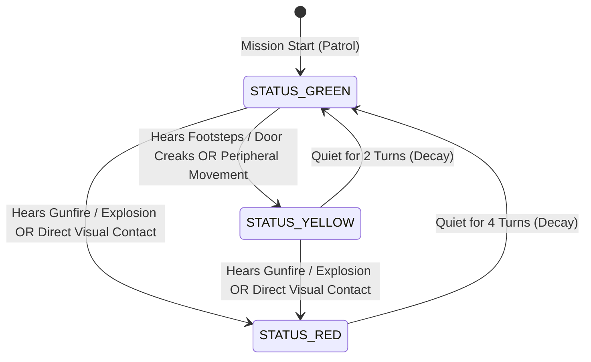

# Jagged Alliance 2 Straciatella Awareness for OpenXcom (OXCE)
### Tactical Acoustics, Auditory Awareness, Alert State Machine, and Peripheral Vision

> [← Back to Documentation Overview](ja2_stracciatella_mods_overview.md)

---

## 1. Overview & Vision

In vanilla OpenXcom, stealth, sound propagation, and peripheral awareness do not exist:
- An alien standing with their back turned is oblivious to a soldier sprinting 2 tiles behind them, smashing open wooden doors, or firing heavy weapons.
- Vision is locked into an unnatural 90° tunnel vision quadrant: soldiers are 100% blind to anything at 91° on their flank.
- Aliens operate as a hivemind: they are either 100% oblivious or instantly alerted across the entire map.

**Jagged Alliance 2 Straciatella Awareness** brings **real-time physical acoustics, intelligent auditory AI investigation, realistic ~180° human peripheral vision, and a 3-tier alert state machine** directly into OpenXcom Extended (OXCE).

---

## 2. Complete List of Changes & Mechanics

### 2.1 The 3-Tier Alert State Machine

1. **`STATUS_GREEN` (Patrol / Unaware)**:
   - Standard unalerted patrol routines. Guards move along waypoints without anticipating hostiles and look straight ahead along their walking vector.
2. **`STATUS_YELLOW` (Suspicious / Investigating)**:
   - **Trigger**: Hearing non-combat acoustic disturbances (footsteps, running, doors opening) or catching movement in peripheral vision.
   - **Behavior**: Guard logs the exact 3D coordinates of the sound (`_noiseTarget`), halts patrol, navigates to investigate, and turns to scan the disturbance area.
   - **Decay**: If quiet for 2 turns, relaxes back to `STATUS_GREEN`.
3. **`STATUS_RED` (Combat Alert / Engaged)**:
   - **Trigger**: Direct visual contact, unmistakable gunfire, or high-explosive detonations.
   - **Behavior**: Full combat readiness. Guards seek hard defensive cover facing the threat, set up ambush angles, and reserve Time Units for reaction fire on your turn.
   - **Decay**: De-escalates after 4 turns of complete silence and no visual contacts.

---

### 2.2 Tactical Acoustics & Sound Propagation
Every physical action emits sound with a specific volume. Sound decays across distance and is muffled by physical structures:

$$\text{EffVolume} = (\text{BaseVolume} \times \text{NoiseFactor}) + \text{HearingBonus} - \text{DistanceInTiles} - \text{Attenuation}_{\text{Walls}} - \text{Attenuation}_{\text{Doors}}$$

- **Free-Air Attenuation**: $-1$ volume per tile traveled.
- **Closed Doors**: Muffles sound by **$-6$ volume** (`acousticDoorAttenuation: 6`).
- **Solid Structural Walls**: Penetrating a solid wall or floor drops sound by **$-10$ volume** (`acousticWallAttenuation: 10`).
- **Species Noise Factor (`noiseMovementFactor`)**: Modifies movement noise based on species anatomy (e.g. Snakeman `0.5`, Sectopod `2.0`).
- **Auditory Hearing Bonus (`hearingBonus`)**: Modifies listening acuity per unit/armor (e.g. Reaper/Chryssalid `+4` to `+5`, sealed Muton helmet `-2`).

#### Acoustic Noise Profiles:
| Action / Item | Base Volume | Open-Air Range | Range Through 1 Wall | Resulting Alert |
| :--- | :---: | :---: | :---: | :---: |
| **Airborne Anti-Grav Flight** | 0 | 0 tiles (Silent) | Silent ($0$) | None |
| **Sneaking Creep (<kbd>Alt</kbd> Key)** | 1 | 1 tile | Silent ($0$) | `STATUS_YELLOW` |
| **Walking Footstep** | 6 | 6 tiles | Silent ($0$) | `STATUS_YELLOW` |
| **Running Sprint** | 14 | 14 tiles | 4 tiles | `STATUS_YELLOW` |
| **Door Opening** | 4 | 4 tiles | Silent ($0$) | `STATUS_YELLOW` |
| **Forced / Smashed Door** | 15 | 15 tiles | 5 tiles | `STATUS_YELLOW` |
| **Pistol Fire** | 25 | 25 tiles | 15 tiles | `STATUS_RED` |
| **Laser Pistol Fire** | 20 | 20 tiles | 10 tiles | `STATUS_RED` |
| **Infantry Rifle Fire** | 35 | 35 tiles | 25 tiles | `STATUS_RED` |
| **Heavy Cannon / Auto-Cannon** | 45 | 45 tiles | 35 tiles | `STATUS_RED` |
| **Heavy Plasma** | 45 | 45 tiles | 35 tiles | `STATUS_RED` |
| **Rocket Launcher Fire** | 50 | 50 tiles | 40 tiles | `STATUS_RED` |
| **High Explosive Blast** | 55 | 55 tiles | 45 tiles | `STATUS_RED` |

---

### 2.3 Auditory AI Investigation & Noise Tracking
*Realistic acoustic reaction without artificial screen radar.*

- **The Problem in Vanilla**: Aliens adhere strictly to predefined patrol routes regardless of loud gunfire, sprinting operatives, or kicked doors right next to them unless they achieve visual contact.
- **The JA2 Mechanic (`acousticSimulation: true`)**:
  - Whenever an operative or alien makes a sound whose effective volume reaches a unit (`effVolume > 0`), the hearing unit records the 3D map coordinates (`_noiseTarget`).
  - **Patrol Break**: If the guard is in `STATUS_YELLOW` or `STATUS_RED`, standard patrol routines are suspended. The guard turns toward the noise and navigates to the disturbance coordinates to investigate.
  - **Decay & Return**: If no further sounds are heard and no enemies are spotted after 2 turns, the guard concludes the investigation and returns to `STATUS_GREEN`.

---

### 2.4 Realistic ~180° Peripheral Vision Arc
*Inspired by human focal vs. peripheral eyesight in Jagged Alliance 2.*

- **The Problem in Vanilla**: Units have a rigid 90° vision cone. An operative looking North cannot see an alien standing at 89° or 91° to their flank.
- **The JA2 Mechanic (`peripheralVision: true`)**:
  - **Focal Cone (90°)**: 100% full view distance (20 tiles Day / 12–16 tiles Night).
  - **Peripheral Arc (~180°)**: The entire forward half-plane (from 9 o'clock to 3 o'clock).
  - **Detection Range Ratio (`peripheralVisionRatio: 0.5`)**: Peripheral vision detects movement, shadows, and weapon flashes at **$50\%$ of normal distance**.
  - **Alert Escalation**: Catching peripheral movement escalates a soldier or guard's status to `STATUS_YELLOW`, prompting them to turn and focus their primary cone on the threat.

---

## 3. How It Affects Gameplay (Player Tactics)

1. **True Tactical Infiltration**:
   - Walking instead of sprinting keeps operatives completely silent through walls. You can quietly stack up outside doors without waking guards.
2. **Breaching Discipline**:
   - Gently opening doors is quiet ($4$ tiles), while blasting open doors with grenades alerts every alien in the building.
3. **Sound Traps & Distractions**:
   - Intentionally fire a loud weapon or smash a window to lure suspicious aliens into pre-aimed kill zones.
4. **No More Blind Flanks**:
   - Operatives will no longer be ambushed by aliens walking 2 tiles beside their shoulder thanks to the 180° peripheral vision arc.

---

## 4. How It Affects Enemies (Alien AI Behavior)

1. **Intelligent Sound Investigation**:
   - In vanilla, aliens walk repetitive patrol paths regardless of noise. Under this mod, hearing footsteps or doors causes guards to break patrol and actively investigate the noise source.
2. **Combat Alertness (`STATUS_RED`)**:
   - Gunfire or explosions alert nearby aliens even without direct visual sight, prompting them to take defensive ambush positions and hold reaction fire.
3. **Alien Peripheral Vision**:
   - Aliens also possess 180° peripheral vision. Operatives cannot sprint past an alien's flank without being detected.

---

## 5. Terror from the Deep (TFTD) Acoustic Profiles

The companion mod **`JA2_Stracciatella_Awareness_TFTD`** configures underwater acoustic propagation across all TFTD gear:

| Action / TFTD Weapon | Base Volume | Open-Water Range | Range Through 1 Bulkhead | Resulting Alert |
| :--- | :---: | :---: | :---: | :---: |
| **Silent Swimming / Sneak (<kbd>Alt</kbd>)** | 1 | 1 tile | Silent ($0$) | `STATUS_YELLOW` |
| **Diver Walking / Swimming** | 6 | 6 tiles | Silent ($0$) | `STATUS_YELLOW` |
| **Sprinting / Rushing** | 14 | 14 tiles | 4 tiles | `STATUS_YELLOW` |
| **Submarine Hatch Opening** | 4 | 4 tiles | Silent ($0$) | `STATUS_YELLOW` |
| **Smashed Hatch / Breach** | 15 | 15 tiles | 5 tiles | `STATUS_YELLOW` |
| **Dart Gun / Pistol** | 20 | 20 tiles | 10 tiles | `STATUS_RED` |
| **Harpoon Gun** | 22 | 22 tiles | 12 tiles | `STATUS_RED` |
| **Gauss Pistol** | 28 | 28 tiles | 18 tiles | `STATUS_RED` |
| **Gauss Rifle** | 35 | 35 tiles | 25 tiles | `STATUS_RED` |
| **Heavy Gauss** | 42 | 42 tiles | 32 tiles | `STATUS_RED` |
| **Hydro-Jet Cannon** | 38 | 38 tiles | 28 tiles | `STATUS_RED` |
| **Gas Cannon** | 42 | 42 tiles | 32 tiles | `STATUS_RED` |
| **Sonic Pistol / Blaster** | 35 / 45 | 35 / 45 tiles | 25 / 35 tiles | `STATUS_RED` |
| **Sonic Cannon / Disrupter Pulse** | 50 | 50 tiles | 40 tiles | `STATUS_RED` |
| **Torpedo Launcher / Magna-Blast** | 55 | 55 tiles | 45 tiles | `STATUS_RED` |

---

## 6. Summary Configuration Matrix

| Hook Name | Default (Vanilla) | Mod Value | Effect |
| :--- | :---: | :---: | :--- |
| `acousticSimulation` | `false` | `true` | Enables real-time acoustic wave propagation through walls and doors. |
| `acousticWallAttenuation` | `0` | `10` | Sound volume loss per solid structural wall. |
| `acousticDoorAttenuation` | `0` | `6` | Sound volume loss per closed door. |
| `noiseMovementWalk` | `0` | `6` | Noise radius for walking footsteps. |
| `noiseMovementRun` | `0` | `14` | Noise radius for sprinting footsteps. |
| `noiseDoorOpen` | `0` | `4` | Noise radius for opening doors. |
| `noiseDoorSmash` | `0` | `15` | Noise radius for smashed doors. |
| `noiseExplosion` | `0` | `55` | Noise radius for explosive detonations. |
| `peripheralVision` | `false` | `true` | Enables ~180° peripheral vision arc. |
| `peripheralVisionRatio` | `0.0` | `0.5` | Detection range ratio in peripheral arc (50% of normal vision). |

---

## 7. How to Enable / Disable

1. Start **OpenXcom** (`make ufo`, `make tftd`, or `make openxcom`).
2. Go to **Options** $\rightarrow$ **Mods**.
3. Under the active master mod:
   - For **UFO / xcom1**: Check `[X] Jagged Alliance 2 Straciatella Awareness`
   - For **TFTD / xcom2**: Check `[X] Jagged Alliance 2 Straciatella Awareness TFTD`
4. Click **OK**.
