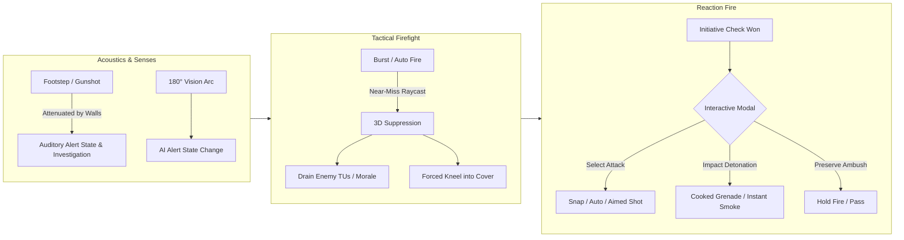

# Jagged Alliance 2 Stracciatella Mods vs. Vanilla OpenXcom: Overview & Mechanics Comparison

### High-Level Summary of Tactical Overhauls, Gameplay Impact, and Shooting Mechanics

---

## 1. Introduction

Vanilla **OpenXcom** (1994) features an exceptional physical 3D voxel engine, but its tactical combat relies on 90s-era abstraction: distance-blind shooting accuracy, flat binary hit-or-miss mechanics, rigid 90° cone vision, global hivemind alertness, and purely automated snap-shot reaction fire.

The **Jagged Alliance 2 (JA2) Stracciatella** mod suite ports the acclaimed tactical depth, realistic ballistics, suppression, acoustics, and interactive interrupts of *Jagged Alliance 2* into **OpenXcom Extended (OXCE)**. 

This document provides a concise, high-level overview comparing vanilla OpenXcom with the modded experience—focusing on how gameplay dynamics, shooting chances, and player strategies change. For detailed formulas, code hooks, and state machines, refer to the dedicated deep-dive guides linked in [Section 8](#8-deep-dive-guides-index).

---

## 2. At-a-Glance Feature Matrix

| Combat System | Vanilla OpenXcom | JA2 Stracciatella Mod Suite | Direct Gameplay Impact |
| :--- | :--- | :--- | :--- |
| **Accuracy by Range** | Flat accuracy across whole map; zero dropoff; point-blank misses. | Scaled effective range; sharp dropoff beyond max range; lethal close up. | Sidearms dominate close quarters; rifles/cannons required for long-range firefights. |
| **Beyond-Visual-Range (BVR)** | Global shared sight; full accuracy at targets spotted by any scout. | **$-50\%$ accuracy penalty** if shooter lacks personal visual contact. | Eliminates Skyranger "ramp-sniping"; spotters and snipers must coordinate. |
| **Automatic Bursts** | Identical accuracy for all 3 bullets; zero recoil; no barrel climb. | Cumulative $-15\%$ recoil penalty per consecutive round + upward climb. | Uncontrolled spraying standing up misses; kneeling/bipod absorbs recoil. |
| **Weapon Bracing / Stance** | Flat $+15\%$ kneel bonus for all weapons equally. | $+20\%$ baseline kneel; up to $+45\%$ bipod bonus for heavy support weapons. | Entrenched machine gunners lock down fire corridors with surgical accuracy. |
| **Obstacle Clearance** | Direct center-of-mass aim clips window sills and low half-cover (`NO LOF`). | **Aim High** (<kbd>Shift</kbd> + click) raises aim $+6$ voxels at $-15\%$ precision cost. | Enables shooting over sandbags and through window apertures without obstruction. |
| **Near-Miss Bullets** | Binary: a miss by 1 inch causes zero impact on target. | **3D Near-Miss Suppression**: drains enemy TUs (up to $25\%$) and shakes morale. | Covering fire pins targets, disables alien reaction fire, and covers advances. |
| **Suppression Stance** | Units remain standing while under heavy fire. | Units take cover (**forced kneel**) after taking 3+ suppression points. | Suppressed targets duck behind cover, lowering their profile from subsequent fire. |
| **Hearing & AI Alertness** | Purely visual; footsteps, opening doors, and sprinting are silent to AI. | **Tactical Acoustics & Alert Hierarchy**: sound travels with decibel decay; muffled by walls/doors. | Stealth walking avoids detection; noise lures guards into pre-aimed ambush positions. |
| **Vision Cones** | Rigid 90° tunnel vision; 100% blind at 91° to flank. | **Realistic ~180° Peripheral Arc** detects movement at 50% max sight range. | Flank ambushes are harder to execute blindly; soldiers notice enemies beside them. |
| **Enemy Alertness** | Binary: either passive patrol or instant map-wide combat awareness. | **3-Tier Alert State Machine**: Patrol (Green) $\to$ Investigate (Yellow) $\to$ Combat (Red). | Enemies inspect suspicious noise coordinates before sounding full combat alarms. |
| **Reaction Overwatch** | Rigid automated single snap shot; zero player decision-making. | **Interactive Reaction Modal**: choose Snap, Burst, Aimed, Grenade, or Hold Fire. | Tactical control during interrupts; throw cooked grenades or hold fire to stay hidden. |
| **Reaction Grenades** | Grenades sit inert on the ground until end-of-turn. | Thrown reaction grenades **detonate on impact** ("cooked") or drop instant smoke. | Instant area denial against advancing terror units and aggressive alien rushes. |
| **AI Range Awareness** | Rigid distance brackets; fires sidearms beyond range; wastes TUs. | **Smart Range & Dropoff AI**: cancels out-of-range shots; aggressively closes the distance. | Aliens armed with sidearms aggressively push into lethal range rather than wasting fire from afar. |

---

## 3. How Shooting Chances & Ballistics Change

### 3.1 Point-Blank Combat vs. Long-Distance Sniping
* **Vanilla**: A rookie with 45% accuracy has a 45% chance to hit an alien 40 tiles away and that *exact same* 45% chance at 1 tile. When a point-blank miss occurs, the 3D raycast deflects the bullet past the narrow alien hitbox into the ground or wall.
* **With JA2 Tactical**:
  * **Point-Blank Boost**: Close-range shots ($\le 3$ tiles) with suitable compact firearms (pistols, SMGs, shotguns) receive massive hit bonuses, reaching up to $99\%$ accuracy.
  * **Effective Range Limits**: Weapons now have realistic maximum ranges (e.g., 15 tiles for pistols, 34 for rifles, 50 for heavy weapons). Beyond this range, accuracy degrades sharply ($-2\%$ to $-4\%$ per tile).
  * **Tactical Result**: Pistols and sidearms become deadly indoor breach weapons, while rifles and cannons maintain mid-to-long-range dominance.

### 3.2 Anti-Ramp Sniping (BVR Penalty)
* **Vanilla**: A forward scout or flying tank spots an alien across the map; soldiers sitting safely inside the Skyranger drop-ship snipe the alien with zero penalty.
* **With JA2 Tactical**:
  * Firing at a target outside the shooter's personal line-of-sight slashes accuracy by **$50\%$**.
  * The targeting crosshair turns **Amber** and displays the `[BVR]` tag.
  * Dedicated optical/sniper rifles bypass or soften this penalty, restoring true spotter-sniper teamwork.

### 3.3 Recoil, Burst Climb, and Bipod Deployment
* **Vanilla**: Auto-bursts fire three rounds with uniform accuracy, even when walking or firing heavy calibers.
* **With JA2 Tactical**:
  * Consecutive burst shots incur a cumulative **$-15\%$ accuracy penalty** ($0\% \to -15\% \to -30\%$) and climb $+1$ voxel vertically.
  * **Kneeling with Heavy Weapons** simulates bipod bracing: boosts accuracy by up to **$+45\%$** and completely absorbs burst recoil.
  * Operatives with high physical strength ($> 40$) naturally absorb recoil on smaller weapons.

### 3.4 Overcoming Cover: Aim High (`Shift + Click`)
* **Vanilla**: Windows and waist-high sandbags frequently block line of fire (`NO LOF`) because the engine rays straight toward the enemy's center of mass (abdomen).
* **With JA2 Tactical**:
  * Holding <kbd>Shift</kbd> aims at the upper silhouette/head ($+6$ voxels higher).
  * Clears window sills and waist-high barricades cleanly in exchange for a balanced **$-15\%$ precision penalty**.

---

## 4. Suppression, Awareness, and Reaction Overhauls

### 4.1 3D Voxel Suppression & Pinning Fire
* Near-miss bullets within 1 tile of an enemy generate **suppression points** based on weapon caliber (Heavy Cannons and Heavy Plasma generate maximum suppression).
* Suppressed enemies lose up to **$25\%$ of their Time Units** on their next turn and suffer morale shock.
* Accumulating 3+ suppression points forces units to immediately **dive to the ground (kneel)**.
* **Tactical Result**: Machine guns become area-denial tools. Laying down a covering burst depletes alien reaction scores, allowing teammates to safely cross open streets or breach doorway choke points.

### 4.2 Tactical Acoustics & Peripheral Vision
* Every step, kicked door, and gunshot generates a sound wave that decays across distance and is muffled by obstacles ($-6$ through closed doors, $-10$ through solid walls).
* Acoustic disturbances alert guards along a 3-tier state machine:
  - `STATUS_GREEN`: Standard patrol.
  - `STATUS_YELLOW`: Suspicious; halts patrol, logs sound origin coordinates (`_noiseTarget`), and moves to investigate the disturbance.
  - `STATUS_RED`: Combat readiness; seeking hard cover, prioritizing ambushes, and reserving reaction TUs.
* A realistic **~180° peripheral vision arc** detects movement at 50% range, eliminating the blind 90° tunnel-vision flank exploit.

### 4.3 Interactive Interrupts & Cooked Grenades
* When a soldier wins a reaction contest, gameplay pauses with an interactive prompt offering all affordable actions: **Snap**, **Auto Burst**, **Aimed Shot**, **Throw Grenade**, or **Hold Fire**.
* **Cooked Grenades**: Reaction-thrown grenades detonate **immediately upon landing** (high explosive) or bloom instantly (smoke), providing emergency crowd control against rushing melee units (e.g., Chryssalids).
* **Hold Fire**: Allows scouts and snipers to decline low-chance shots and maintain concealment for higher-priority targets.
### 4.4 Alien Sensory & Tactical Rebalance
* **Asymmetrical Night Vision**: Replaces flat 20-tile alien omniscience with authentic tiers: biological line infantry (14–15 tiles), nocturnal predators (16–18 tiles), and cybernetic/psionic masters (20 tiles).
* **Thermal & Psionic Senses**: Cyberdiscs and Sectopods pierce smoke screens with 100% active thermal targeting (`heatVision`); Snakemen have 50% thermal pits; Ethereals perceive human minds through walls (`psiVision: 12–16 tiles`).
* **Suppression Immunities**: Mindless horrors (Chryssalids, Silacoids, Zombies) and combat machines (Cyberdiscs, Sectopods) cannot be suppressed or forced to kneel (`fearImmune: true`, `allowsKneeling: false`). Humanoid infantry (Mutons, Sectoids) dive for cover under heavy fire.
* **Acoustic Stealth & Movement Noise**: Snakemen (`0.5`) and Chryssalids (`0.6`) slither and stalk with muffled footsteps (3 tiles), while Sectopods (`2.0`) clank loudly across terrain (12 tiles). Airborne units glide silently through the air.
* **Spotter & Sniper Networks**: Agile scouts (Floaters, Cyberdiscs, Sectoid Navigators) designate player positions (`spotter: 1–2`), allowing heavy gunners (Muton Engineers, Sectopods) to deliver long-range fire without personal line-of-sight penalties (`sniper: 1–3`).
* **Smart AI Tactical Combat**: Integrated tactical intelligence—reaction fire threshold (holds overwatch fire for $\ge 25\%$ hit chances), end-of-turn defensive kneeling behind cover, sound-origin facing on acoustic investigation, weapon scavenging when disarmed, and anti-decoy threat prioritization.

---

## 5. Visual HUD Indicators & In-Game Options

To give players complete clarity over these new mechanics without cluttering the tactical battlefield with ground drawings, indicators are integrated directly into the crosshair HUD:

* **Cursor Status Tags (`ja2sRangeVisualCursorTags`)**: Real-time crosshair labels indicating `[BVR]` (beyond personal sight), `[RANGE]` (beyond weapon effective range), `[HIGH]` (elevated aim active), and distance statistics `[dist: X / max: Y]`.
* **Pre-Shot Line of Fire (`ja2sVisualLOFIndicator`)**: Real-time `NO LOF` indicator warns when terrain, corners, or friendly units block bullet trajectories before spending TUs.
* **Target Elevation / Aim High (`ja2sAllowAimHigh`)**: Allows holding <kbd>Shift</kbd> to target upper silhouette over half-cover.
* **Suppression UI Alerts (`ja2sSuppressionVisualFeedback`)**: Displays `<Unit> IS PINNED DOWN!` in the HitLog when a unit is suppressed.
* **In-Game JA2S Configuration Tab**: All active JA2 features can be individually customized or toggled via **Options $\rightarrow$ Advanced $\rightarrow$ JA2S**.

---

## 6. Mod Interdependence & Synergy Matrix

All Jagged Alliance 2 Stracciatella mods are designed with **strict modular independence** at the engine level while offering **seamless tactical synergy** when combined.

### 6.1 Technical Independence vs. Design Synergy

* **Technical Independence**: All 5 mods declare only `master: xcom1`. None of them require any other mod to function. You can enable any single mod, any combination of two or three, or all five together. The engine will never crash or fail to load if one is missing.
* **Design Synergy**: While the 4 core mechanics mods (`Tactical`, `Awareness`, `Suppression`, `Reaction`) introduce new battle rules, `JA2_Stracciatella_Aliens` acts as the **companion tuning mod** that balances enemy sensory and psychological profiles against those systems.

### 6.2 Interdependence Matrix

| Mod | Technical Independence | What It Governs | Dependencies & Synergies |
| :--- | :---: | :--- | :--- |
| **`JA2_Stracciatella_Tactical`** | **100% Standalone** | Ballistics, ranges, BVR accuracy penalty ($-50\%$), burst recoil climb, bipod kneel bonuses, Aim High (<kbd>Shift</kbd>), and baseline human night vision (12 tiles). | **None.** Operates completely on its own. |
| **`JA2_Stracciatella_Awareness`** | **100% Standalone** | Tactical acoustics, footsteps/doors/gunfire noise propagation, 3-tier alert state machine (Green/Yellow/Red), and ~180° peripheral vision. | **None.** Operates completely on its own. |
| **`JA2_Stracciatella_Suppression`** | **100% Standalone** | 3D voxel near-miss detection, target TU drain (up to 25%), morale shock, forced defensive kneeling, and reaction overwatch disruption. | **None.** Operates completely on its own. |
| **`JA2_Stracciatella_Reaction`** | **100% Standalone** | Interactive interrupt prompt (Snap, Auto, Aimed, Grenade, Hold Fire), cooked impact grenade detonation, and AI reaction range selection (Auto $\le 6$, Aimed $\ge 15$). | **None.** Operates completely on its own. |
| **`JA2_Stracciatella_Aliens`** | **100% Standalone** *(Soft Synergy)* | Alien night vision tiers (14–20 tiles), thermal smoke vision (`heatVision`), psionic wall sight (`psiVision`), suppression immunities, acoustic stealth (`noiseMovementFactor`), hearing bonuses, and spotter/sniper AI roles. | **Soft Synergy with Tactical, Awareness, and Suppression** (see below). |

### 6.3 Cross-Mod Synergy Breakdown

1. **`Aliens` + `Tactical`**:
   - `Tactical` imposes a 50% Beyond-Visual-Range (BVR) penalty on shots outside personal line-of-sight. `Aliens` equips scout aliens with `spotter: 1–2` and heavy gunners with `sniper: 1–3`, teaching alien squads to coordinate long-range fire without BVR penalties.
   - `Tactical` elevates human night vision to 12–16 tiles; `Aliens` scales alien night vision to 14–16 tiles (instead of vanilla's flat 20), creating fair, symmetrical night firefights.
2. **`Aliens` + `Awareness`**:
   - `Awareness` activates the 3D acoustic simulation engine.
   - `Aliens` supplies species-specific acoustic stealth (Snakemen slithering at `0.5` volume, Ethereals levitating at `0.3`) and predatory hearing (Reaper/Chryssalid `+4` to `+5` hearing bonus). *(If Awareness is off, these acoustic parameters sit dormant without errors).*
3. **`Aliens` + `Suppression`**:
   - `Suppression` introduces near-miss pinning and forced kneeling.
   - `Aliens` grants suppression immunity (`fearImmune: true`, `allowsKneeling: false`) to combat machines (Cyberdiscs, Sectopods) and mindless horrors (Chryssalids, Silacoids, Zombies), ensuring only humanoid infantry (Mutons, Sectoids) dive for cover.

### 6.4 Recommended Loadout Presets

* **Full JA2 Combat Overhaul (Recommended)**: Enable all 5 mods together. Every mechanic is fully active and the alien roster is calibrated against player capabilities.
* **Weapons & Ballistics Only**: Enable `JA2_Stracciatella_Tactical` for authentic weapon ranges, recoil climb, and bipods.
* **Tactical Stealth & Infiltration**: Enable `JA2_Stracciatella_Awareness` + `JA2_Stracciatella_Aliens` for acoustic detection, stealth walking, and predatory hunting.
* **Firefights & Ambushes**: Enable `JA2_Stracciatella_Suppression` + `JA2_Stracciatella_Reaction` for covering fire and interactive reaction overwatch.

---

## 7. Terror from the Deep (TFTD) Support & Companion Mods

The entire JA2 Stracciatella engine is **100% compatible** with *Terror from the Deep* (`xcom2`).

Because OpenXcom isolates rulesets between UFO Defense (`master: xcom1`) and TFTD (`master: xcom2`), the suite provides 5 dedicated companion mods for TFTD under `bin/standard/`:

1. **`JA2_Stracciatella_Tactical_TFTD`**:
   - Weapon effective ranges and recoil profiles for the entire TFTD underwater/surface arsenal:
     - **Dart Gun / Dart Pistol**: Close-quarters sidearms (ranges 14–16, zero bipod, high point-blank accuracy).
     - **Harpoon Gun**: Compact carbine (range 28, small bipod bonus).
     - **Gas Cannon**: Heavy ballistic support (range 40, +40% bipod kneel bonus, high recoil).
     - **Hydro-Jet Cannon**: Aquatic assault machine gun (range 35, +35% bipod bonus).
     - **Gauss Series**: Gauss Pistol (18), Gauss Rifle (34), Heavy Gauss (42, +40% bipod).
     - **Sonic Series**: Sonic Pistol (20), Sonic Blaster (36), Sonic Cannon (45, +45% bipod).
     - **Torpedo Launchers & Disrupters**: Heavy ordinance (ranges 45–50).
   - **Chemical Flare**: Enhanced illumination (`visibilityAtDarkBonus: 4`).
   - Standard human diver night vision calibrated to 12 tiles.

2. **`JA2_Stracciatella_Awareness_TFTD`**:
   - Calibrated underwater acoustics and acoustic shockwaves for all TFTD harpoons, gauss rifles, and sonic beam weapons.

3. **`JA2_Stracciatella_Suppression_TFTD`**:
   - Realistic suppression ratings across all underwater weaponry:
     - Heavy aquatic ordnance (Gas Cannon, Heavy Gauss, Sonic Cannon, Torpedoes) deliver maximum 3D voxel suppression.
     - Medium weapons (Gauss Rifle, Sonic Blaster, Hydro-Jet) provide pinning fire.

4. **`JA2_Stracciatella_Reaction_TFTD`**:
   - Full interactive interrupts (Snap, Auto, Aimed, Cooked Grenades, Hold Fire) and AI range heuristics configured for `master: xcom2`.

5. **`JA2_Stracciatella_Aliens_TFTD`**:
   - Complete TFTD alien sensory overhaul:
     - **Aquatoid & Gillman Infantry**: Scaled night vision (14–16 tiles), suppression vulnerability (`allowsKneeling: true`), spotter/sniper AI roles.
     - **Tasoth Warriors**: Enhanced vision (17–18 tiles), 50% thermal targeting, psionic clairvoyance (Leader psiVision: 8).
     - **Lobstermen & Triscenes**: Heavy chitin stomp footfalls (10–13 tiles), high suppression resistance.
     - **Tentaculats**: Terrifying underwater stealth gliders (`noiseMovementFactor: 0.4`, 2 tiles), acute hearing (+4), immune to suppression.
     - **Bio-Drones & Calcinites**: Complete suppression immunity (`fearImmune: true`), 100% active thermal vision.

### 7.1 Master Game Compatibility Matrix

| Mod Name (UFO Defense) | Companion Mod (TFTD) | Master Key | Mod Dependency |
| :--- | :--- | :---: | :---: |
| `JA2_Stracciatella_Tactical` | `JA2_Stracciatella_Tactical_TFTD` | `xcom1` / `xcom2` | None (100% Standalone) |
| `JA2_Stracciatella_Awareness` | `JA2_Stracciatella_Awareness_TFTD` | `xcom1` / `xcom2` | None (100% Standalone) |
| `JA2_Stracciatella_Suppression` | `JA2_Stracciatella_Suppression_TFTD` | `xcom1` / `xcom2` | None (100% Standalone) |
| `JA2_Stracciatella_Reaction` | `JA2_Stracciatella_Reaction_TFTD` | `xcom1` / `xcom2` | None (100% Standalone) |
| `JA2_Stracciatella_Aliens` | `JA2_Stracciatella_Aliens_TFTD` | `xcom1` / `xcom2` | None (Soft synergy with above) |

---

## 8. Deep-Dive Guides Index

For full mathematical equations, code hooks, ruleset YAML configurations, and tactical examples, refer to the individual component guides:

### Core Mechanics & Mod Guides
* [ja2_ballistics_and_accuracy_guide.md](ja2_ballistics_and_accuracy_guide.md) — Comprehensive analysis of point-blank mechanics, UFOextender accuracy integration, and the 6-step ballistics pipeline.
* [ja2_stracciatella_tactical_guide.md](ja2_stracciatella_tactical_guide.md) — Weapon effective ranges, stance modifiers, burst recoil climb, and Aim High sub-voxel targeting.
* [ja2_stracciatella_suppression_guide.md](ja2_stracciatella_suppression_guide.md) — 3D voxel near-miss tracking, TU drain, morale shock, forced kneeling, and combat logging.
* [ja2_stracciatella_awareness_guide.md](ja2_stracciatella_awareness_guide.md) — Acoustic wave propagation, wall/door decibel attenuation, noise investigation, and peripheral vision.
* [ja2_stracciatella_reaction_guide.md](ja2_stracciatella_reaction_guide.md) — Interactive interrupt modal prompt, weapon attack modes, cooked impact grenades, and AI reaction ranges.
* [ja2_stracciatella_alien_rebalance_guide.md](ja2_stracciatella_alien_rebalance_guide.md) — Alien sensory rebalance, night vision tiers, suppression resistances, acoustic profiles, and spotter AI network.

### Architectural Comparisons & Technical Investigations
* [aiming_shooting_los_comparison_ja2_openxcom.md](aiming_shooting_los_comparison_ja2_openxcom.md) — Architectural and technical comparison of Jagged Alliance 2 (Stracciatella v0.22.1) and OpenXcom aiming, hit calculation, ballistics, line of sight, and squad-spotting algorithms.
* [tactical_combat_investigation_topics_ja2_openxcom.md](tactical_combat_investigation_topics_ja2_openxcom.md) — Strategic roadmap and deep comparative analysis exploring 7 key tactical combat mechanics (suppression, interrupts, stances, terminal ballistics, trauma, shrapnel, modular attachments).
