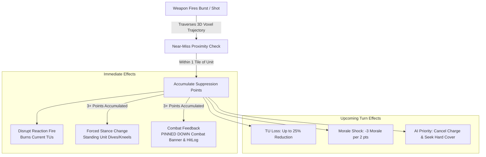

# Jagged Alliance 2 Straciatella Suppression for OpenXcom (OXCE)
### Bullet Suppression, Pinning Fire, Reaction Overwatch Disruption, and Combat UI

> [← Back to Documentation Overview](ja2_stracciatella_mods_overview.md)

---

## 1. Overview & Vision

In vanilla OpenXcom, bullets operate on a strict binary hit-or-miss model:
- If a heavy plasma burst narrowly misses your soldier by 2 inches, your soldier suffers zero penalty: they start their next turn with 100% Time Units, full morale, and pristine accuracy.
- Machine guns like the Heavy Cannon or Auto-Cannon are treated merely as inaccurate single-target damage dealers rather than weapons of area suppression.
- Advancing on an alien holding reaction overwatch is often suicidal.

**Jagged Alliance 2 Straciatella Suppression** brings Jagged Alliance 2's physical suppression philosophy directly into OpenXcom's 3D voxel engine. Near-miss bullets now physically matter: they generate **suppression points**, drain Time Units, erode morale, force standing soldiers to dive into cover, disrupt deadly alien reaction fire, and display clear **combat text notifications**.

---

## 2. Complete List of Changes & Mechanics



---

### 2.1 3D Voxel Near-Miss Trajectory Tracking
OpenXcom tracks projectiles through continuous 3D voxel space:
- When a bullet flies along its raycast trajectory, the engine checks a **1-tile perimeter around the trajectory line**.
- Any opposing unit whose tile intersects this near-miss corridor accumulates suppression points based on the weapon's caliber:

| Weapon Type | Suppression Factor / Bullet | Tactical Role |
| :--- | :---: | :--- |
| **Pistols & Sidearms** | **1 pt** | Light harassment; minimal suppression. |
| **Infantry Rifles** | **2 pts** | Medium suppression; effective in coordinated focus fire. |
| **Auto-Cannon / Heavy Cannon** | **3–4 pts** | **Lethal suppression weapon**; bursts pin targets down instantly. |
| **Heavy Laser / Heavy Plasma** | **4 pts** | Terrifying concussive alien energy; rapidly breaks enemy posture. |
| **Rocket Launchers** | **5 pts** | Devastating psychological shockwave. |

---

### 2.2 Time Unit (TU) Penalties & Pinning
Suppressed units suffer a Time Unit deduction on their upcoming turn:

$$\text{TU Penalty} = \min\left(\text{BaseTU} \times 25\%, \; \text{SuppressionPoints} \times 2\right)$$

- A heavily suppressed unit loses up to **$25\%$ of their Time Units** on their next turn.
- Pinned enemies behind cover cannot easily peek, fire an aimed shot, and duck back—they are forced to spend their limited TUs either hunkering down or taking desperate low-accuracy snap shots.

---

### 2.3 Immediate Reaction Overwatch Disruption
- Every near-miss bullet deducts from the target's **current Time Units** in real-time.
- Because reaction fire score is calculated as $\text{Reactions} \times \frac{\text{Current TU}}{\text{Base TU}}$, laying down suppressive fire directly **erodes the enemy's reaction score**.
- **Tactical Clearing**: Firing a covering burst down an alien corridor reduces the alien's reaction score, allowing teammates to cross safely without drawing reaction fire.

---

### 2.4 Forced Defensive Kneeling ("Hit the Dirt!")
*Inspired by JA2's automatic crouching/prone reaction when under heavy fire.*

- If a standing soldier or alien accumulates **$3$ or more suppression points** from an incoming burst:
  - The unit immediately dives to the ground (**forces kneeling stance**).
  - Dropping down reduces the unit's vertical hitbox from 22 to 14 voxels, allowing waist-high cover (sandbags, fences, windows) to block subsequent incoming bullets.

---

### 2.5 Morale Shock
Incoming heavy fire shakes soldiers and aliens alike:
$$\text{Morale Loss} = \left(\frac{\text{SuppressionPoints}}{2}\right) \times 3$$
- Pinned soldiers facing overwhelming firepower suffer morale degradation, eventually triggering panic or frantic retreat if left unsupported.

---

### 2.6 Visual UI Feedback & Combat Logging
*Inspired by JA2's floating status text.*

- **Visual Feedback (`suppressionVisualFeedback: true`)**:
  - When a unit accumulates $\ge 3$ suppression points, a combat notification is logged to the **HitLog**:
    ```text
    <Unit Name> IS PINNED DOWN!
    ```
  - Displays instant visual clarity when an alien's overwatch has been successfully broken.

---

## 3. How It Affects Gameplay (Player Tactics)

1. **Machine Guns as True Area Denial**: The Heavy Cannon, Auto-Cannon, and Heavy Laser become indispensable tactical tools for pinning down dangerous snipers.
2. **Breaching Chokepoints**: You can safely breach guarded doors by laying down suppressive fire first to burn the enemy's reaction TUs.
3. **Player Vulnerability**: Advancing soldiers caught in open terrain by alien bursts will be forced to hit the dirt, losing TUs and falling behind schedule.

---

## 4. How It Affects Enemies (Alien AI Behavior)

1. **Suppressed Alien Priority Shift**:
   - The AI recognizes when it is pinned down under heavy fire.
   - **Reckless Charges Aborted**: Suppressed aliens cancel aggressive pushes.
   - **Hard Cover Focus**: The AI increases preference for defensive ambush cover ($+80\%$ ambush preference, $-40\%$ combat odds), hiding behind obstacles until the suppression wears off.
2. **Disrupting Alien Reaction Fire**:
   - Terrifying alien reaction snipers (e.g. Mutons, Sectopods) can be neutralized by suppressive fire without needing a direct hit.

---

## 5. Terror from the Deep (TFTD) Suppression Specifications

The companion mod **`JA2_Stracciatella_Suppression_TFTD`** configures 3D suppression across the entire TFTD underwater arsenal:

| TFTD Weapon | Suppression Factor / Bullet | Tactical Role |
| :--- | :---: | :--- |
| **Dart Gun / Dart Pistol** | **1 pt** | Light harassment; minimal disruption. |
| **Harpoon Gun / Gauss Pistol** | **2 pts** | Medium suppression; effective in concentrated focus fire. |
| **Gauss Rifle / Sonic Pistol** | **2–3 pts** | Reliable suppressive fire; breaks enemy reaction overwatch. |
| **Hydro-Jet Cannon** | **3 pts** | Sustained automatic pinning; locks down underwater choke points. |
| **Gas Cannon / Heavy Gauss** | **4 pts** | **Lethal suppression weapon**; bursts force targets to hit the seabed immediately. |
| **Sonic Blaster** | **3–4 pts** | Heavy alien acoustic pulses shaking morale. |
| **Sonic Cannon / Disrupter Pulse** | **4–5 pts** | Concussive underwater blast; instant forced kneeling. |
| **Torpedo Launcher** | **5 pts** | Devastating hydrodynamic shockwave. |

---

## 6. Summary Configuration Matrix

| Hook Name | Default (Vanilla) | Mod Value | Effect |
| :--- | :---: | :---: | :--- |
| `nearMissSuppression` | `false` | `true` | Enables 3D trajectory near-miss suppression tracking. |
| `suppressionVisualFeedback` | `false` | `true` | Enables combat notifications and HitLog alerts when pinned. |
| `nearMissRadius` | `0` | `1` | Proximity radius in tiles around bullet path. |
| `suppressionMaxTUPenalty` | `0` | `25` | Maximum percentage of Time Units lost to suppression. |
| `suppressionMoraleLoss` | `0` | `3` | Morale shock per suppression threshold. |
| `suppressionKneelThreshold` | `0` | `3` | Suppression points required to force standing units to kneel. |

---

## 7. How to Enable / Disable

1. Start **OpenXcom** (`make ufo`, `make tftd`, or `make openxcom`).
2. Go to **Options** $\rightarrow$ **Mods**.
3. Under the active master mod:
   - For **UFO / xcom1**: Check `[X] Jagged Alliance 2 Straciatella Suppression`
   - For **TFTD / xcom2**: Check `[X] Jagged Alliance 2 Straciatella Suppression TFTD`
4. Click **OK**.
